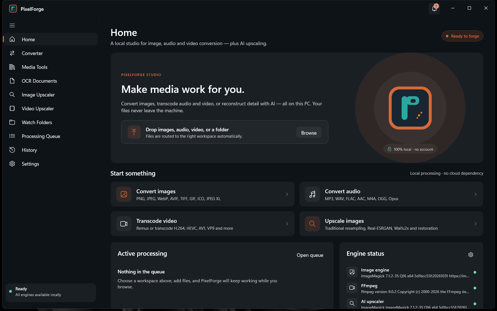
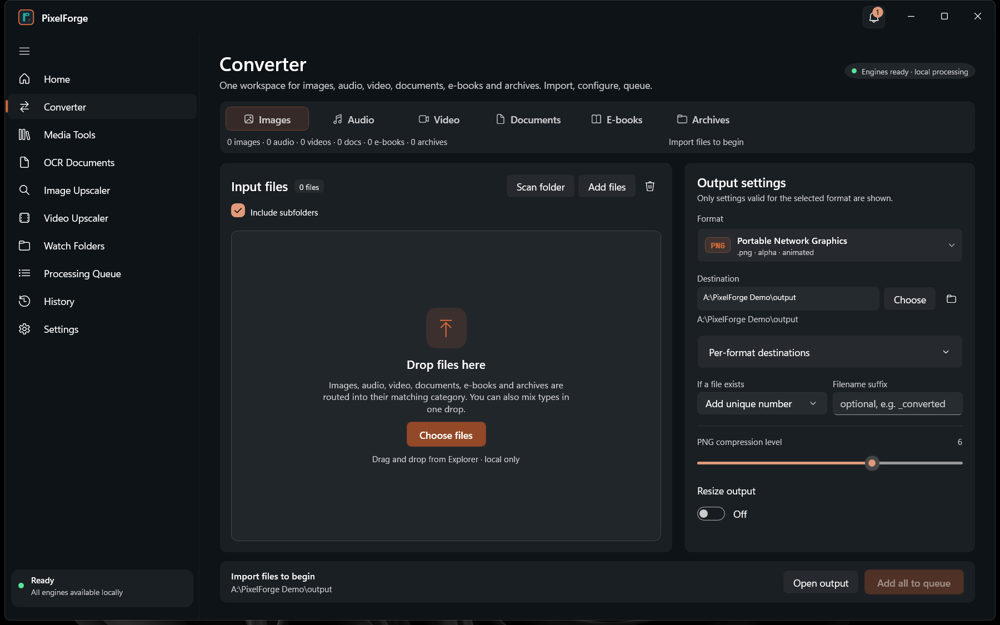
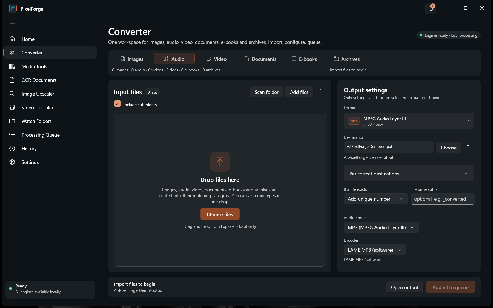
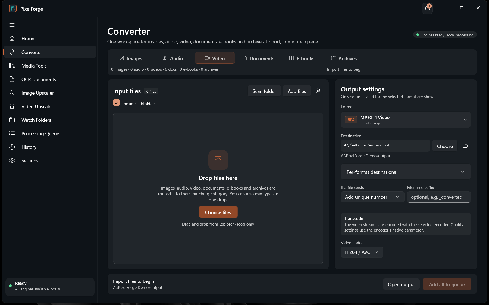
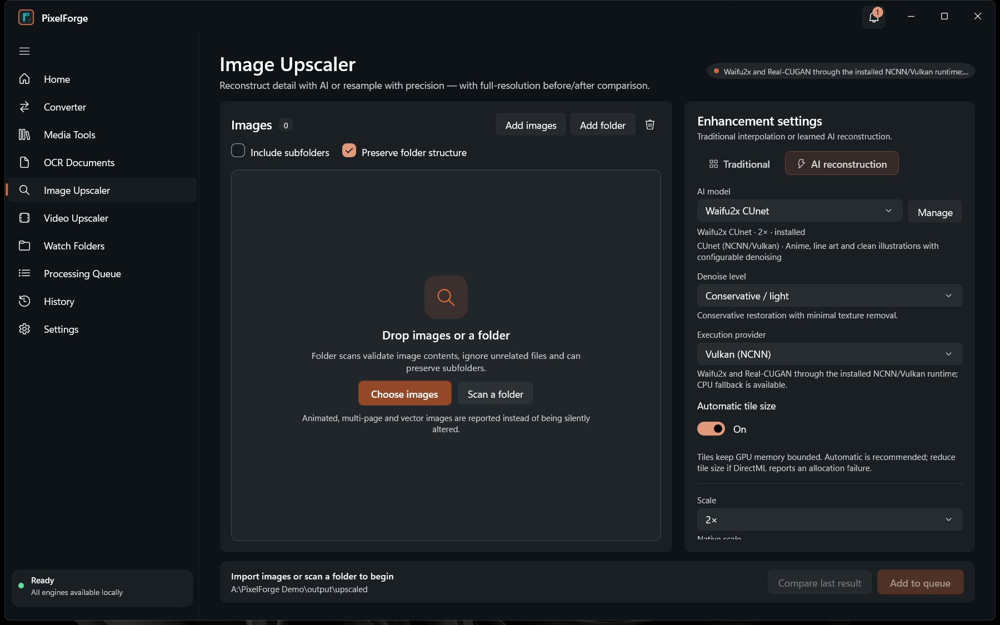
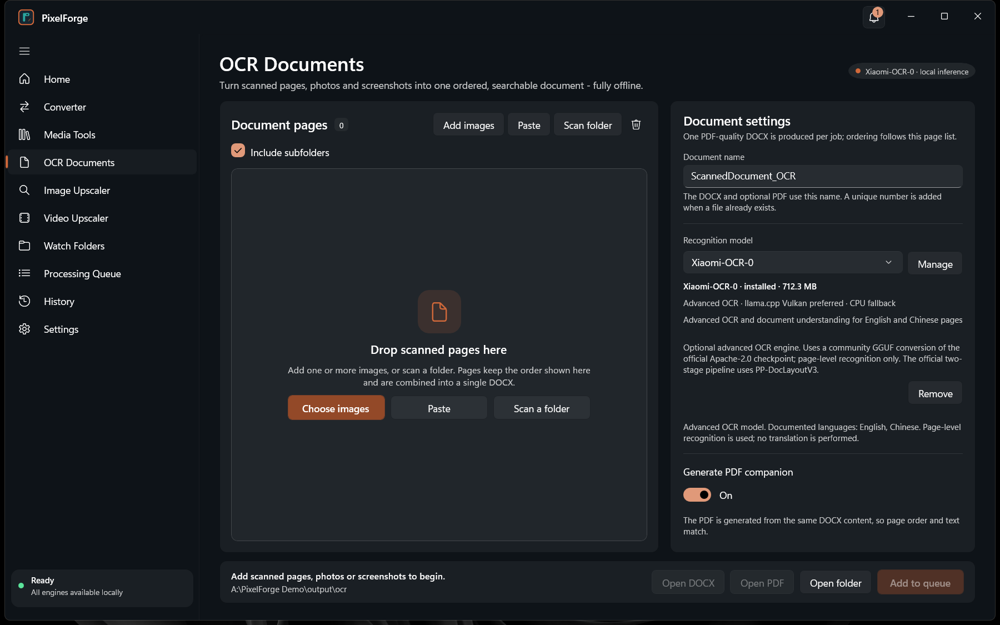
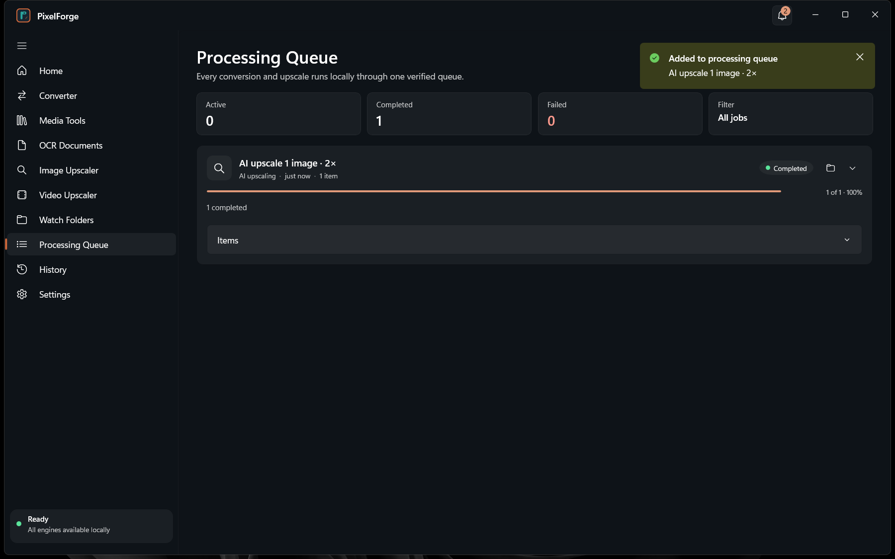
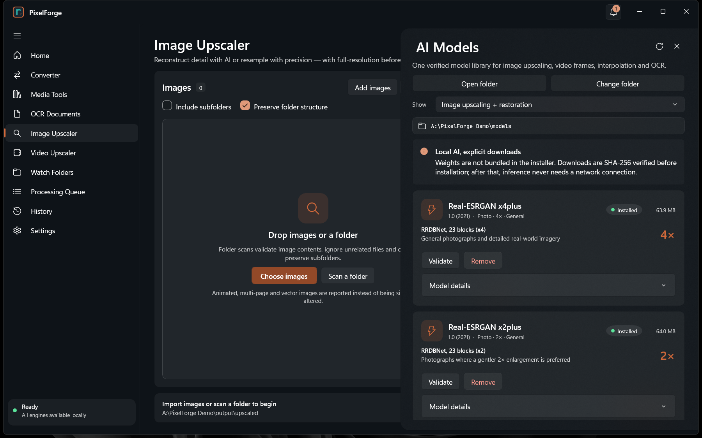
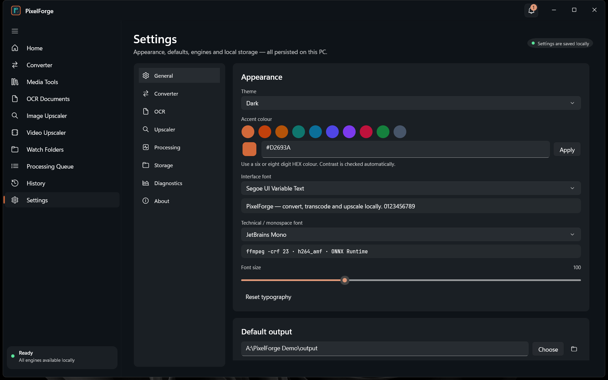

# PixelForge

**A local Windows studio for converting, processing, upscaling, and OCR-ing media — without an account or cloud service.**

PixelForge brings image, audio, video, document, e-book, and archive conversion into one Windows application, alongside focused media tools, a persistent processing queue, local AI upscaling, video super-resolution, and OCR document generation. Everything runs on your PC.

[](https://github.com/JuggyBob/PixelForge/actions/workflows/ci.yml)
[](LICENSE)
[](https://github.com/JuggyBob/PixelForge/releases/latest)



## Download

| Package | Download |
|---|---|
| Windows x64 installer | [PixelForge-Setup-1.0.0-x64.exe](https://github.com/JuggyBob/PixelForge/releases/download/v1.0.0/PixelForge-Setup-1.0.0-x64.exe) |
| Portable ZIP | [PixelForge-Portable-1.0.0-x64.zip](https://github.com/JuggyBob/PixelForge/releases/download/v1.0.0/PixelForge-Portable-1.0.0-x64.zip) |
| Checksums | [SHA256SUMS.txt](https://github.com/JuggyBob/PixelForge/releases/download/v1.0.0/SHA256SUMS.txt) |

The installer is per-user and does not require administrator rights. The portable ZIP can be extracted anywhere.

## Table of contents

- [Overview](#overview)
- [Visual tour](#visual-tour)
- [Features](#features)
- [Supported formats](#supported-formats)
- [Installation](#installation)
- [Quick start](#quick-start)
- [System requirements](#system-requirements)
- [Dependencies and AI models](#dependencies-and-ai-models)
- [Building from source](#building-from-source)
- [Configuration and data](#configuration-and-data)
- [Troubleshooting](#troubleshooting)
- [Privacy and security](#privacy-and-security)
- [Known limitations](#known-limitations)
- [Code signing policy](#code-signing-policy)
- [Contributing](#contributing)
- [License](#license)
- [Security reporting](#security-reporting)
- [Acknowledgments](#acknowledgments)

## Overview

PixelForge is a native Windows desktop application built with .NET 10 and WinUI 3. It orchestrates proven local engines: FFmpeg, ImageMagick through Magick.NET, Pandoc, Typst, 7-Zip, Zstandard, ONNX Runtime with DirectML, NCNN, and llama.cpp.

The application is designed for people who need a dependable local media workflow:

- Convert images, audio, video, documents, e-books, and archives in one place.
- Apply focused audio, image, and video operations without a scripting pipeline.
- Upscale images with traditional resampling or local AI models.
- Upscale video frame by frame and interpolate frame rates with RIFE.
- Turn scanned pages into ordered DOCX and PDF documents.
- Automate repeat work with watch folders and a persistent queue.
- Keep a searchable local history without storing copies of your media.

PixelForge does not require a subscription, an account, a browser, Docker, Python, or a web server. Optional model weights are downloaded only when you ask for them and are verified before use.

## Visual tour

### Image conversion



The Converter adapts to the selected category. Formats, codecs, quality controls, destination, collision handling, and metadata options are shown only when they apply.

### Audio conversion



Choose a container and compatible codec, then control bitrate or quality, sample rate, channels, metadata, and destination.

### Video conversion



Transcode or remux video with codec-aware presets, hardware encoding where a real encode probe succeeds, subtitle handling, and FFprobe verification.

### AI image upscaling



Use five traditional resampling algorithms or local AI models including Real-ESRGAN, SwinIR, SPAN, SCUNet, NAFNet, Waifu2x, and Real-CUGAN. Tiled inference keeps memory bounded.

### OCR documents



Order scanned pages, choose PP-OCRv6 or an optional advanced model, and produce one DOCX with an optional PDF companion. Reading order is column-aware.

### Processing queue



Jobs, progress, cancellation, retries, verification, and output access live in one persistent queue. Interrupted jobs are recovered on restart.

### Model management



Inspect installed and available models, install from the catalogue or a local file, verify hashes, and remove models without removing shared runtimes.

### Settings



Themes, accent colour, fonts, font scaling, conversion defaults, OCR options, processing concurrency, storage retention, and diagnostics are persisted locally.

More screenshots are available in [docs/SCREENSHOTS.md](docs/SCREENSHOTS.md).

## Features

### Converter workspace

- Six categories: Images, Audio, Video, Documents, E-books, and Archives.
- Shared staged-file session across categories, so you can prepare a mixed batch and queue every category together.
- File picker, drag and drop, folder scanning, recursive scans, duplicate suppression, output-folder exclusion, and ignored-file reporting.
- Collision policies: add a unique number, overwrite, skip, or fail.
- Per-format output destinations and optional filename suffixes.
- Metadata controls for documents, e-books, audio, and video where the target supports them.

### Image processing and upscaling

- Image conversion through ImageMagick with PNG, JPEG, WebP, AVIF, TIFF, BMP, GIF, ICO, JPEG XL, TGA, PNM, OpenEXR, Radiance HDR, QOI, and DDS output where the installed build supports them.
- Animated and multipage preservation where the target permits it; explicit flattening when it does not.
- EXIF orientation normalization, alpha handling, ICC preservation, and bounded memory for large images.
- Traditional upscaling: nearest, bilinear, bicubic, Lanczos, and Mitchell.
- ONNX models: Real-ESRGAN x4plus/x2plus/Anime 6B/General x4 v3/AnimeVideo v3, SwinIR Real-SR, SPAN, SCUNet, and NAFNet.
- NCNN/Vulkan models: Waifu2x CUnet, Upconv Anime, Upconv Photo, Real-CUGAN SE, and Real-CUGAN Pro.
- CPU, DirectML, and Vulkan providers where appropriate; automatic tiling and configurable tile overlap.
- Folder scanning, recursive output structure, batch import, and a before/after inspector with synchronized zoom and pan.

### Audio and video

- Audio containers: MP3, WAV, FLAC, M4A, AAC, OGG, and Opus, with codec-aware bitrate, quality, sample rate, channel, and metadata controls.
- Video containers: MP4, MKV, MOV, WebM, AVI, and animated GIF; stream copy or re-encode.
- H.264, H.265/HEVC, AV1, VP9, VP8, MPEG-4 Part 2, and Apple ProRes video codecs where available.
- AAC, ALAC, FLAC, MP3, Opus, Vorbis, and PCM audio codecs depending on the container.
- Hardware encoders are exposed only after a real encode probe succeeds; CPU fallback remains available.
- Video super-resolution frame by frame with compatible image models, plus RIFE 4.25 interpolation at 2x, 3x, or 4x.
- Scene-cut detection, audio preservation or re-encoding, output dimensions, frame rate, duration, and readability verification.

### Media tools

- Audio: EBU R128/LUFS two-pass loudness normalisation, spectral denoise, RNNoise, silence removal, trim, merge, channel and sample-rate conversion, metadata and cover art, and extraction from video.
- Image: optimise/compress, deterministic batch edit (crop, resize, denoise, sharpen, colour, watermark, metadata), EXIF/IPTC editing, and local u2netp background removal.
- Video: target-size compression, trim, merge, stabilisation, thumbnail, GIF, audio extraction/replacement, subtitle extraction/conversion/embedding/dropping, metadata, HDR-to-SDR, and resolution/frame-rate conversion.

### OCR documents

- Page picker, drag and drop, clipboard paste, folder scan, manual ordering, and sort modes.
- PP-OCRv6 Tiny, Small, and Medium through ONNX Runtime with DirectML or CPU.
- Optional GLM-OCR, MiniCPM-OCR 1.0, and Xiaomi-OCR-0 through a local llama.cpp runtime.
- Column-aware reading order; headings, paragraphs, lists, simple tables, and page breaks reconstructed into DOCX.
- Optional PDF generated from the same ordered DOCX content.
- Low-confidence page warnings and explicit unsupported-input reporting.

### Queue, history, and automation

- Persistent central queue with configurable concurrency, per-job and per-item cancellation, retry, failure reasons, and interrupted-job recovery.
- Watch folders that wait for stable files, respect subfolder settings, avoid output loops, persist processed-file state, and enqueue ordinary queue jobs.
- SQLite-backed history with search, filters, open/reveal/repeat/compare actions, and retention controls.
- In-app notification centre with unread badge and live progress.
- Local-only operation; no telemetry or background network calls.

## Supported formats

Format support is determined by the bundled engines at runtime. The converter only offers a target when the installed engine reports that it can write it.

| Category | Common outputs |
|---|---|
| Images | PNG, JPEG, WebP, AVIF, TIFF, BMP, GIF, ICO, JPEG XL, TGA, PNM, OpenEXR, HDR, QOI, DDS |
| Audio | MP3, WAV, FLAC, M4A, AAC, OGG, Opus |
| Video | MP4, MKV, MOV, WebM, AVI, animated GIF |
| Documents | PDF, DOCX, ODT, RTF, TXT, HTML, Markdown |
| E-books | EPUB |
| Archives | ZIP, 7Z, TAR, GZ, BZ2, XZ, Zstandard |

See [docs/SUPPORTED_FORMATS.md](docs/SUPPORTED_FORMATS.md) for detailed input/output tables, codec notes, OCR model limits, and archive safety behavior.

## Installation

### Setup installer

1. Download `PixelForge-Setup-1.0.0-x64.exe` from the [v1.0.0 release](https://github.com/JuggyBob/PixelForge/releases/tag/v1.0.0).
2. Run the installer. It installs per user by default to `%LOCALAPPDATA%\Programs\PixelForge`.
3. Start PixelForge from the Start menu. A desktop shortcut is optional.
4. To remove it, use **Settings > Apps > PixelForge > Uninstall**, or the uninstaller in the installation folder.

The installer does not require administrator rights. It includes FFmpeg, Pandoc, Typst, 7-Zip, Zstandard, ImageMagick, ONNX Runtime, the bundled offline helper models, and the required Windows App SDK runtime.

### Portable ZIP

1. Download `PixelForge-Portable-1.0.0-x64.zip`.
2. Extract it to a folder you can write to.
3. Run `PixelForge.exe`.
4. By default, user data lives in `%LOCALAPPDATA%\PixelForge`; set `PIXELFORGE_DATA_DIR` to keep a profile beside the application.

The portable package contains the same runtime engines as the installer. It does not register shortcuts or an uninstaller.

### Optional AI models

Real-ESRGAN, SwinIR, SPAN, SCUNet, NAFNet, RIFE, PP-OCRv6 (Small/Medium), and advanced OCR models are **not** included in the base download. Open the shared **AI Models** panel from Settings, Image Upscaler, Video Upscaler, or OCR Documents to install them. Downloads are SHA-256 verified before installation, and advanced OCR runtimes are installed only when needed.

## Quick start

### Convert media

1. Open **Converter**.
2. Choose Images, Audio, Video, Documents, E-books, or Archives.
3. Add files, scan a folder, or drop files onto the workspace.
4. Select a target format and review the settings shown for that format.
5. Choose a destination and collision policy.
6. Select **Add all to queue**.

### Upscale an image

1. Open **Image Upscaler**.
2. Add images or scan a folder.
3. Choose a traditional algorithm or an AI model, scale, provider, and tiling options.
4. Add to the queue, then compare input and output in History.

### Create an OCR document

1. Open **OCR Documents**.
2. Add or paste page images and arrange their order.
3. Choose a recognition model and document name.
4. Optionally enable PDF output.
5. Add the job to the queue.

### Automate a folder

1. Open **Watch Folders**.
2. Choose input/output folders, a category, a format, and subfolder behavior.
3. Create the rule. Stable new files are validated and queued automatically.

## System requirements

| Requirement | Minimum | Recommended |
|---|---|---|
| Windows | Windows 10 version 1809 (build 17763) | Windows 11 |
| Architecture | x64 | x64 |
| Memory | 8 GB | 16 GB or more for AI/video work |
| Disk | 1 GB free for the application; additional space for models and outputs | SSD with room for model weights and temporary frames |
| Graphics | DirectX-capable system | DirectML-compatible GPU for AI acceleration; Vulkan GPU for NCNN/llama.cpp |

The self-contained installer and portable package include the .NET runtime and Windows App SDK runtime. No separate developer SDK is needed to run the application. Hardware acceleration depends on the GPU and driver; PixelForge falls back to CPU where supported and reports unavailable encoders instead of pretending they exist.

## Dependencies and AI models

PixelForge uses external engines as separate processes or local libraries:

- **FFmpeg/FFprobe** for audio/video conversion, probing, and media tools.
- **Pandoc** for document conversion and **Typst** for PDF generation.
- **7-Zip** and **Zstandard** for archive creation, extraction, and compression.
- **ImageMagick through Magick.NET** for image decoding, conversion, and processing.
- **ONNX Runtime with DirectML** for image models, PP-OCRv6, and video upscaling.
- **NCNN/Vulkan** for Waifu2x and Real-CUGAN, downloaded with the selected model.
- **llama.cpp/Vulkan** for optional advanced OCR, downloaded when needed.

Bundled offline helper models: u2netp background removal and RNNoise speech denoising. Large AI model weights are optional downloads. Each model's source, license, size, and SHA-256 are recorded in the application's model catalogue and in [THIRD_PARTY_NOTICES.md](THIRD_PARTY_NOTICES.md).

## Building from source

### Prerequisites

- Windows 10 1809 or later (Windows 11 recommended).
- .NET SDK 10.0.404 or later.
- Windows SDK 10.0.26100.
- Visual Studio 2022/2026 Build Tools with the Windows application development/C++ workload for WinUI native dependencies.
- PowerShell 7.
- Inno Setup 7 only if you want to build the installer; place `ISCC.exe` under `tools\InnoSetup`.

### Restore, build, and test

```powershell
dotnet restore PixelForge.sln
dotnet build PixelForge.sln -c Release -p:Platform=x64
dotnet test tests\PixelForge.Tests.Unit\PixelForge.Tests.Unit.csproj -c Release --no-build
```

Integration and UI tests require the external engines and optional model fixtures. See [docs/BUILDING.md](docs/BUILDING.md).

### Build release packages

```powershell
powershell -NoProfile -ExecutionPolicy Bypass -File scripts\build-release.ps1 -Version 1.0.0
```

Outputs:

```text
artifacts\installer\PixelForge-1.0.0-Setup.exe
artifacts\portable\PixelForge-1.0.0-portable.zip
artifacts\SHA256SUMS.txt
```

The release script publishes a self-contained x64 build, removes development symbols, creates the portable ZIP, builds the per-user installer, and generates SHA-256 checksums.

## Configuration and data

| Data | Default location |
|---|---|
| Settings, queue database, history, logs, caches | `%LOCALAPPDATA%\PixelForge` |
| Installed application | `%LOCALAPPDATA%\Programs\PixelForge` |
| Default output | `%USERPROFILE%\Pictures\PixelForge Output` (configurable) |
| Downloaded models and runtimes | `%LOCALAPPDATA%\PixelForge\models` and `%LOCALAPPDATA%\PixelForge\runtimes` |

Set `PIXELFORGE_DATA_DIR` to a writable folder to use an isolated profile. PixelForge creates missing directories on first launch.

## Troubleshooting

### The application does not start

Confirm that the package was extracted completely (portable) or reinstalled (setup). Check the latest log under `%LOCALAPPDATA%\PixelForge\logs`. If the window opens but remains empty, update the graphics driver and try again.

### FFmpeg or Pandoc is reported missing

The installer and portable archive include the required engines. A source build needs `scripts\fetch-dependencies.ps1` and the document tools described in [docs/BUILDING.md](docs/BUILDING.md). Verify that the `ffmpeg`, `documents`, and `archives` folders are next to `PixelForge.exe`.

### Hardware encoding is unavailable

PixelForge probes hardware encoders with a short real encode. Encoder availability depends on the GPU, driver, codec, and FFmpeg build. Use a software encoder or update the graphics driver.

### AI model download fails

Check network access and free disk space. Model downloads are explicit and SHA-256 verified. Use **AI Models > Install from file** if the upstream host is unavailable. Advanced OCR requires the llama.cpp runtime; NCNN models require a Vulkan-capable GPU or a working CPU fallback.

### An OCR page needs review

Dense columns, tables with merged cells, seals, handwriting, and decorative layouts can still require manual review. Try a higher PP-OCRv6 tier or an advanced OCR model. OCR does not translate content.

## Privacy and security

All normal processing runs locally. PixelForge does not include telemetry, analytics, or background cloud calls. Network access occurs only when you explicitly download a model or runtime. The llama.cpp advanced-OCR server binds to loopback for the duration of a job.

PixelForge stores settings, queue state, history, logs, and optional models in its local application-data folder. It does not upload media. See [PRIVACY.md](PRIVACY.md) for the full privacy policy and [SECURITY.md](SECURITY.md) for vulnerability reporting.

## Known limitations

- Windows x64 only at this release. macOS and Linux are not supported.
- Hardware acceleration is not universal; the application reports unavailable providers and falls back to CPU where supported.
- Advanced OCR models and AI upscalers are optional downloads and add significant disk usage.
- OCR is page-level reconstruction, not full document-layout analysis; complex forms and handwriting may need review.
- Video super-resolution uses frame-by-frame AI models; fast motion can show temporal shimmer.
- DRM-protected e-books are refused; PixelForge does not bypass DRM.
- The initial v1.0.0 installer is not code-signed. SignPath Foundation enrollment is in progress; signed releases will follow. Windows SmartScreen may show a warning for the unsigned build.

## Code signing policy

Free code signing provided by [SignPath.io](https://about.signpath.io), certificate by [SignPath Foundation](https://signpath.org).

| Role | Member |
|---|---|
| Author and committer | [JuggyBob](https://github.com/JuggyBob) |
| Reviewer | [JuggyBob](https://github.com/JuggyBob) |
| Approver | [JuggyBob](https://github.com/JuggyBob) |

Release builds run on GitHub-hosted runners, are submitted to SignPath, and require manual approval for every signing request. The application executable and the setup executable are Authenticode-signed and timestamped; the executable inside the portable ZIP is signed as well. The certificate is issued to SignPath Foundation, so Windows displays SignPath Foundation as the publisher.

PixelForge 1.0.0 predates enrollment and remains unsigned. Existing release assets will not be replaced; signed binaries will be published in a later version after approval. See [CODE_SIGNING.md](CODE_SIGNING.md) for the complete policy and [docs/SIGNPATH.md](docs/SIGNPATH.md) for the setup and release procedure.

## Contributing

Contributions are welcome. Read [CONTRIBUTING.md](CONTRIBUTING.md) for development setup, build/test expectations, branch naming, and pull-request guidance. Participation is governed by [CODE_OF_CONDUCT.md](CODE_OF_CONDUCT.md).

## License

PixelForge is licensed under the **Apache License 2.0**. See [LICENSE](LICENSE) and [NOTICE](NOTICE). Third-party components and optional model weights retain their own licenses; see [THIRD_PARTY_NOTICES.md](THIRD_PARTY_NOTICES.md) and the `licenses/` directory.

## Security reporting

Please do not disclose security issues publicly before they are investigated. Use GitHub's private vulnerability reporting on this repository, or open a minimal issue asking for a private contact channel without including exploit details. See [SECURITY.md](SECURITY.md).

## Acknowledgments

PixelForge builds on the work of the FFmpeg, ImageMagick, Magick.NET, Pandoc, Typst, 7-Zip, Zstandard, ONNX Runtime, DirectML, NCNN, llama.cpp, PaddleOCR, Real-ESRGAN, SwinIR, SPAN, SCUNet, NAFNet, RIFE, Waifu2x, Real-CUGAN, and JetBrains Mono projects. Their licenses and source links are listed in [THIRD_PARTY_NOTICES.md](THIRD_PARTY_NOTICES.md).
